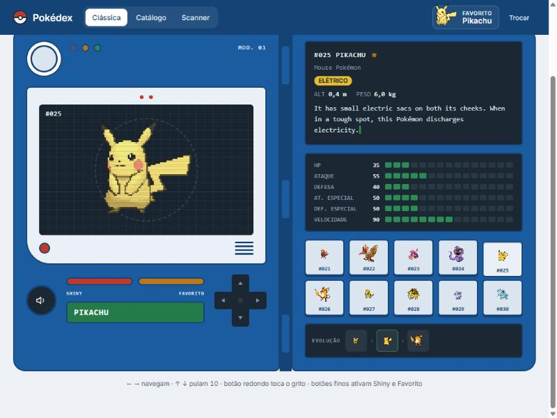
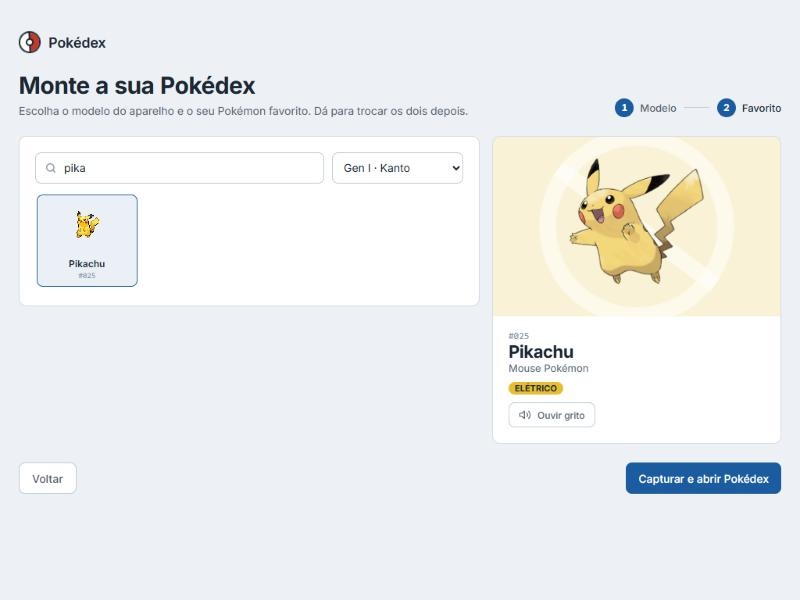
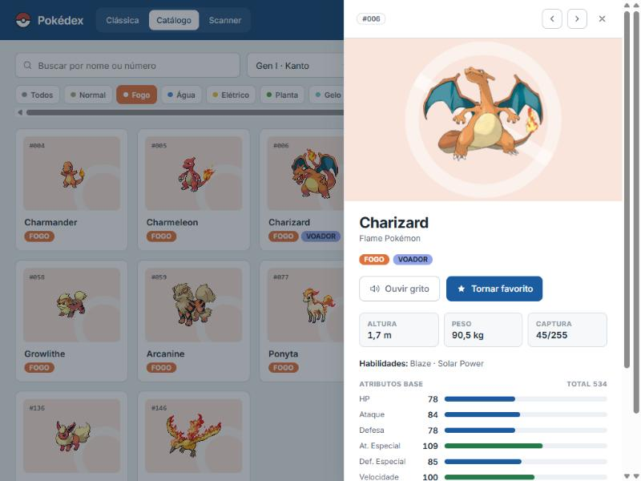
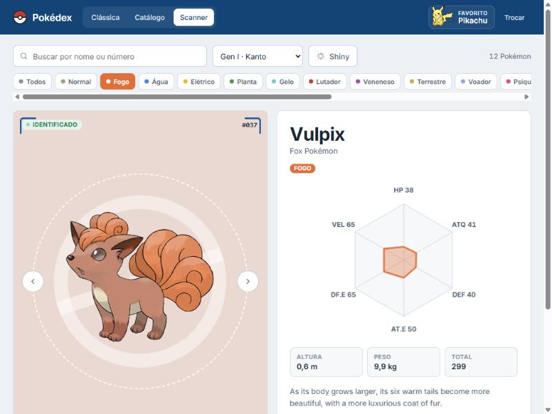
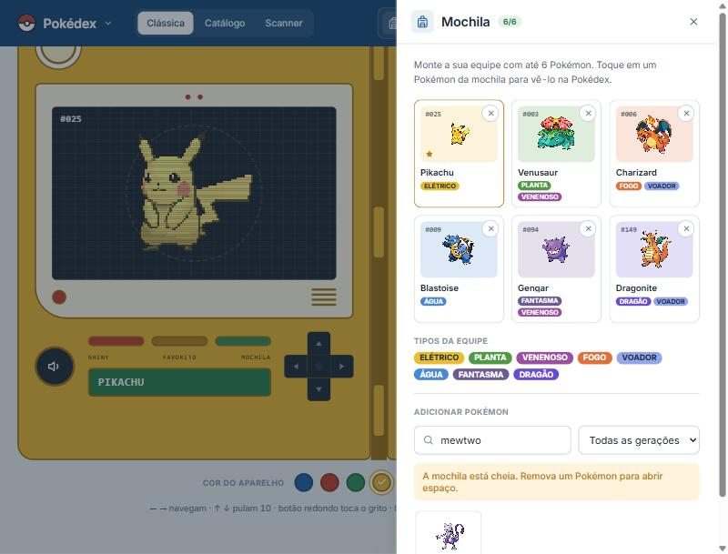
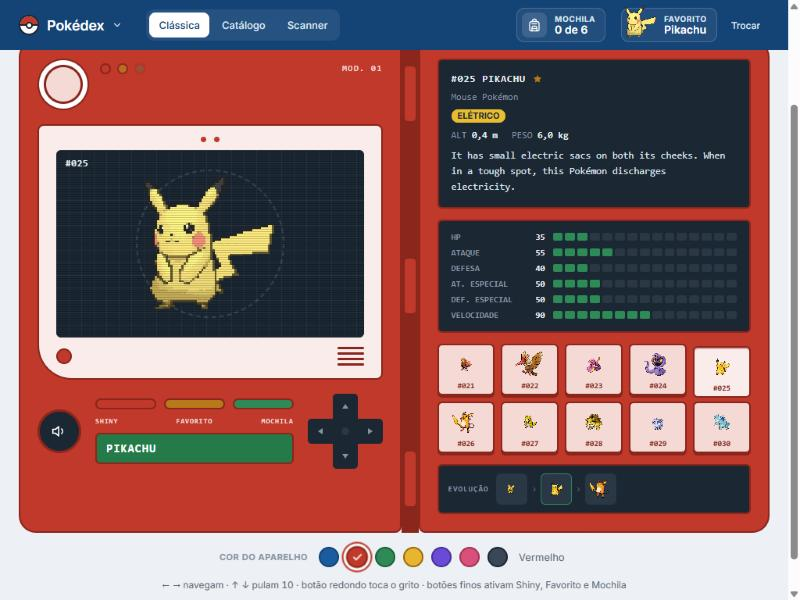
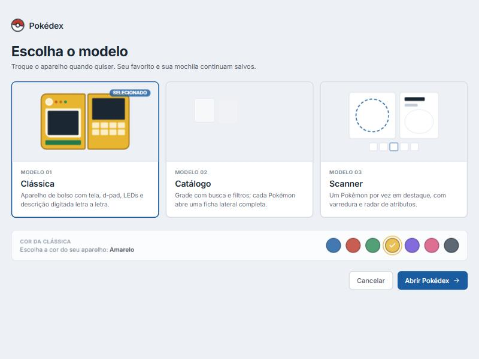

<div align="center">

# ◓ Pokédex

**Uma Pokédex interativa com 3 modelos de aparelho, 1.025 Pokémon e muita animação.**

Escolha o seu modelo, capture o seu Pokémon favorito e explore todas as gerações, de Kanto a Paldea.


### [▶ Abrir a Pokédex](https://sasuzin.github.io/PokeDex---JS/)

<sub>Funciona direto no navegador, no computador ou no celular: https://sasuzin.github.io/PokeDex---JS/</sub>



</div>

---

## ✨ O que ela faz

- 🎮 **3 modelos de Pokédex**: troque a qualquer momento pelo cabeçalho ou clicando em **Pokédex**, no canto superior.
- 🎨 **Pokédex do seu jeito**: o modelo Clássica vem em 7 cores (azul, vermelho, verde, amarelo, roxo, rosa e grafite).
- 🎒 **Mochila com a sua equipe**: escolha até 6 Pokémon favoritos e veja os tipos que a equipe cobre.
- ⭐ **Pokémon favorito** com animação de captura: a Pokébola é arremessada, balança três vezes e… *Capturado!*
- 🔎 **Busca e filtros** por nome, número, geração (I a IX) e os 18 tipos.
- ✨ **Modo Shiny**, que troca todos os sprites e artes pela versão brilhante.
- 🔊 **Grito de cada Pokémon**, tocado direto da PokéAPI.
- 🧬 **Linha evolutiva** clicável, atributos base, altura, peso, habilidades e taxa de captura.
- ⌨️ **Atalhos de teclado**: `←` `→` navegam, `↑` `↓` pulam 10 (na Clássica) e `Esc` fecha a ficha.
- 💾 **Lembra das suas escolhas**: modelo, cor, favorito e mochila ficam salvos no navegador.
- 📱 **Responsiva**: funciona do celular ao monitor grande.
- ♿ **Respeita "reduzir movimento"**: se o sistema pedir menos animação, as animações são desligadas.

## 🕹️ Os 3 modelos

| | Modelo | Como é |
|---|---|---|
| **01** | **Clássica** | Aparelho de bolso com tela de LED, d-pad, luzes piscando e a descrição digitada letra a letra. A cor do aparelho é você quem escolhe. |
| **02** | **Catálogo** | Grade com todos os Pokémon; cada um abre uma ficha lateral completa, com barras de atributos animadas. |
| **03** | **Scanner** | Um Pokémon por vez em destaque, com varredura, gráfico de radar dos atributos e uma faixa de vizinhos. |

<table>
  <tr>
    <td align="center"><br><sub><b>Montagem:</b> escolha do favorito</sub></td>
    <td align="center"><br><sub><b>Catálogo:</b> ficha lateral</sub></td>
  </tr>
  <tr>
    <td align="center"><br><sub><b>Clássica:</b> aparelho de bolso</sub></td>
    <td align="center"><br><sub><b>Scanner:</b> radar de atributos</sub></td>
  </tr>
  <tr>
    <td align="center"><br><sub><b>Mochila:</b> a sua equipe de 6</sub></td>
    <td align="center"><br><sub><b>Clássica:</b> agora em 7 cores</sub></td>
  </tr>
</table>

### 🎒 Mochila

Abra a **Mochila** pelo cabeçalho para montar a sua equipe:

- Busque por nome, número ou geração e toque para pôr ou tirar um Pokémon.
- Cada espaço mostra o Pokémon e os tipos dele, e logo abaixo aparecem **todos os tipos que a equipe cobre**.
- Toque em um Pokémon da mochila para abri-lo direto na Pokédex.
- Também dá para adicionar sem abrir o painel: pelo botão **Pôr na mochila** (Catálogo e Scanner) ou pela pílula verde **MOCHILA** (Clássica).
- O seu favorito entra na mochila automaticamente ao ser capturado.

### 🎨 Troca de modelo e cor

Clique em **Pokédex**, no canto superior esquerdo, para voltar à escolha do modelo. Com a **Clássica** selecionada, aparece a paleta de cores do aparelho. A mesma paleta fica embaixo do aparelho, para trocar a cor sem sair da tela.

<p align="center"></p>

## 🚀 Como usar

### Online

Acesse **https://sasuzin.github.io/PokeDex---JS/**. Não precisa instalar nada.

O site é publicado no GitHub Pages pelo workflow [`.github/workflows/pages.yml`](.github/workflows/pages.yml). Cada push na `main` atualiza o link em cerca de um minuto.

### No seu computador

O projeto não tem dependências para instalar nem etapa de build. Basta servir a pasta `Pokemon Classes` com qualquer servidor estático. É preciso um servidor porque o código usa ES modules, que não funcionam abrindo o arquivo direto.

```bash
git clone https://github.com/Sasuzin/PokeDex---JS.git
cd PokeDex---JS
python -m http.server 5500 --directory "Pokemon Classes"
```

Depois, abra **http://localhost:5500** no navegador.

> 💡 Sem Python? `npx serve "Pokemon Classes"` também funciona.

Na primeira visita a Pokédex baixa o índice com os 1.025 Pokémon e guarda no navegador. Nas próximas, abre na hora.

## 🧱 Como foi feita

- **JavaScript puro com ES modules**, sem bundler.
- **[Preact](https://preactjs.com) + [htm](https://github.com/developit/htm)**: componentes no estilo React, escritos com template strings e carregados direto de um CDN.
- **[PokéAPI](https://pokeapi.co)** para todos os dados: espécies, tipos, atributos, descrições, evoluções e gritos.
- **Sprites** do repositório [PokeAPI/sprites](https://github.com/PokeAPI/sprites): pixel art, arte oficial e sprites animados.
- **CSS puro** para as animações e a Pokébola (ela é feita só com `div`s).

### Estrutura

```
Pokemon Classes/
├── index.html            # Página que carrega a Pokédex
├── css/pokedex.css       # Base, animações e estilos reaproveitados
├── js/
│   ├── main.js           # Ponto de entrada
│   ├── lib.js            # Preact + htm (CDN)
│   ├── dados.js          # Tipos, gerações, endpoints e formatação
│   ├── pokedex.js        # Componente principal: estado, PokéAPI e navegação
│   ├── ui.js             # Pokébola, ícones, selos de tipo…
│   └── telas/            # setup, cabeçalho, clássica, catálogo, scanner, mochila e captura
└── script.js             # Exercício original de classes (herança com Pokemon → Fogo/Água/Planta)
```

## 📚 Origem do projeto

Tudo começou como um exercício de **classes e herança em JavaScript** (`script.js`). Uma classe `Pokemon` dá origem aos tipos `Fogo`, `Agua` e `Planta`, e cada tipo leva mais dano do seu ponto fraco. Esse começo continua no repositório. Depois vieram a PokéAPI e a Pokédex completa.

## ⚖️ Aviso

Projeto de fã, feito para estudo e sem fins comerciais. Pokémon e todos os nomes, imagens e sons relacionados são marcas registradas da Nintendo, Game Freak e The Pokémon Company. Os dados e imagens vêm da [PokéAPI](https://pokeapi.co).

<div align="center">
<sub>Feito com ❤️ e muitas Pokébolas.</sub>
</div>
